<div align="center">

# 📐 DesignWithMath

### Pure Mathematical Art, 3D Raymarched Cinema, Differential Geometry & Homotopy-Annealed Equation Synthesis Engine

<p align="center">
  <a href="LICENSE"></a>
  
  
  
  
  
</p>

<p align="center">
  <em>Synthesize 100% original 2D double-exponential pixel-field paintings, parametric curves, real-time 3D SDF raymarched sculptures, minimal surfaces, PDE simulations, 4D non-Euclidean animations, and complete multi-act mathematical films — governed entirely by explicit closed-form equations.</em>
</p>

[2D Math Art & Solutions](#-original-2d-pure-math-masterpieces-with-complete-formula-solutions) •
[3D Raymarching](#-ultra-hd-3d-sphere-traced-raymarching-minimal-surfaces--non-euclidean-art) •
[Live Cinema](#-live-animated-mathematical-cinema) •
[8 Master Paradigms](#-stage-1--8-master-mathematical-paradigms) •
[H-DGES Autodiff](#-h-dges-homotopy-annealed-differentiable-gompertz-harmonic-synthesis) •
[Quick Start](#-quick-start) •
[Limitations](#-honest-engineering-limitations)

</div>

---

## 🎨 Original 2D Pure-Math Masterpieces (With Complete Formula Solutions)

> **Zero diffusion models. Zero neural pixel generators. Zero 3D polygon meshes.**  
> Every artwork in this gallery is a **100% original creation** authored directly in explicit closed-form mathematics using double-exponential Gompertz survival kernels, analytic Porter–Duff front-to-back occlusion, golden-angle phyllotaxis, dihedral group folding, and multi-octave trigonometric fields.  
> Every single poster below is **100% reproducible offline** (zero API keys) via `python backend/original_2d_artworks.py`.

### 1. Sacred Lotus & Golden Koi Pond at Dawn

<div align="center">
  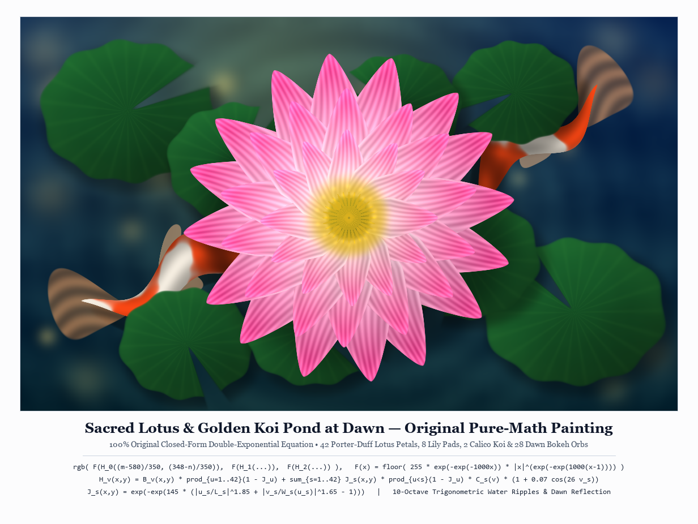
  <br>
  <em><b>Figure 1:</b> <b>Sacred Lotus &amp; Golden Koi Pond at Dawn</b> — 42 Porter–Duff overlapping silk-striated lotus petals, 28 golden stamen beads, 8 radial-veined lily pads with V-notches &amp; cast shadows, 2 swimming calico Koi fish, and 10-octave rippled dawn bokeh water.</em>
</div>

<details>
<summary>📐 <b>View Complete Closed-Form Mathematical Formula Solution — Sacred Lotus &amp; Golden Koi Pond</b></summary>

#### Pixel Domain, Quantization & Core Operators

For pixel coordinates $(m, n) \in \{1,\dots,1160\}\times\{1,\dots,696\}$, define normalized domain coordinates $(x, y) \in [-1.66, 1.66]\times[-1, 1]$ and the shared $C^\infty$ Gompertz survival mask $\Phi_\kappa$ and Hamid-paradigm channel quantizer $F$:

$$F(z) = \left\lfloor 255\, e^{-e^{-1000z}}\,|z|^{e^{-e^{1000(z-1)}}} \right\rfloor, \qquad \Phi_\kappa(g) = \exp\!\big(-\exp(\kappa\, g)\big), \qquad \operatorname{RGB}(m,n) = \big(F(H_0),\, F(H_1),\, F(H_2)\big)$$

Multi-octave anisotropic trigonometric turbulence field (10 octaves):

$$E(x,y) = \sum_{s=1}^{10} 0.55\,(0.72)^{s-1}\cos\!\Big(1.65\,(1.48)^{s-1}(x\cos(1.19s)+y\sin(1.19s)) + 2\cos(3s^2)\Big)\cos\!\Big(1.65\,(1.48)^{s-1}(-x\sin(1.19s)+y\cos(1.19s)) + 2\sin(5s^2)\Big)$$

#### 1. Dawn Pond Water, Concentric Ripples & 28 Bokeh Orbs

With $r_c = \sqrt{x^2 + (y+0.04)^2}$, concentric ripple interference $W_r = 0.55\sin(32 r_c - 1.2 E)e^{-0.9 r_c} + 0.35\cos(18y + 2.4x + 1.5 E)$, and warm horizon reflection $D = e^{-0.9((x+0.35)^2+(y-0.85)^2)}$, the background field accumulates 28 Gaussian dawn bokeh orbs:

$$B_v(x,y) = c_{v,0} + c_{v,1} D + c_{v,2}\operatorname{clip}(W_r,-1,1) + c_{v,3}E + \sum_{s=1}^{28} \gamma_v (0.14 + 0.12D)\exp\!\left(-\frac{(x-b_{x,s})^2+(y-b_{y,s})^2}{r_{b,s}^2}\right)$$

where $b_{x,s} = 1.55\sin(2.13s + 0.7\cos s^2)$, $b_{y,s} = 0.92\cos(1.71s^2 + 0.4s)$, and $r_{b,s} = 0.045 + 0.08\big(\tfrac{1}{2}+\tfrac{1}{2}\sin(3.3s)\big)$.

#### 2. Swimming Calico Koi Fish & Radial-Veined Lily Pads

Each Koi fish $q \in \{1,2\}$ rotates into local spine coordinates $(u_q, v_q)$ with sinusoidal S-curve deflection $v_{s,q} = v_q - d_q\cdot 0.075\sin(4.2 u_q / L_q)$ and tapered teardrop body implicit $g_{\text{koi},q} = (u_q/L_q)^2 + \big(v_{s,q}/(R_q\,\tau(u_q))\big)^2 - 1$, masked by $\Phi_{95}(g_{\text{koi},q})$ with trigonometric calico patches $\Phi_{14}\!\big(\cos(10u_q + 2.2E)\cos(14v_{s,q} - 1.5E) - 0.08\big)$ and translucent webbed fins.

Each of the 8 floating lily pads $p \in \{1,\dots,8\}$ uses polar offset angle $\theta_p = \operatorname{atan2}(y-y_p, x-x_p) - \alpha_p$, scalloped boundary $g_{\text{pad},p} = r_{\text{ell},p} - (1 + 0.03\cos(10\theta_p) + 0.02E)$, radial V-notch subtraction $N_p = \Phi_{80}(|\theta_p|-0.16)\,\Phi_{40}(0.08 - r_{\text{ell},p})$, and radial venation $V_p = 0.08\,|\cos(11\theta_p)|^{12} e^{-0.5 r_{\text{ell},p}}$:

$$M_{\text{pad},p}(x,y) = \Phi_{110}(g_{\text{pad},p})\cdot\big(1 - N_p(x,y)\big)$$

#### 3. 42 Front-to-Back Porter–Duff Lotus Petals & 28 Stamen Beads

Three concentric tiers ($12 + 14 + 16 = 42$ petals) at angles $\phi_s = \frac{2\pi i}{n_t} + \alpha_t + 0.04\sin(2.3i)$ transform into rotated petal coordinates $(u_s, v_s)$ with smooth tip taper $W_s(u_s) = w_t\operatorname{clip}\!\big(1 - 0.42\max(\hat{u}_s,0) - 0.28\max(-\hat{u}_s,0),\, 0.12,\, 1.15\big)$ where $\hat{u}_s = u_s/L_t$ and $\hat{v}_s = v_s/W_s(u_s)$:

$$J_s(x,y) = \Phi_{145}\!\left(|\hat{u}_s|^{1.85} + |\hat{v}_s|^{1.65} - 1\right), \qquad S_{\text{silk}}(\hat{u}_s,\hat{v}_s) = 0.07\cos\!\big(26\hat{v}_s + 2.5\sin(3\hat{u}_s)\big)$$

Composited strictly front-to-back (28 stamen beads $\to$ central seed receptacle $\to$ inner, middle, and outer petal tiers) via exact analytic Porter–Duff occlusion:

$$H_v(x,y) = B_v^{\text{pond}}(x,y)\prod_{u=1}^{71}\big(1 - J_u(x,y)\big) + \sum_{s=1}^{71} J_s(x,y)\left(\prod_{u=1}^{s-1}\big(1 - J_u(x,y)\big)\right) C_{s,v}(x,y)$$

> **Exact reproducible source:** `render_original_lotus_koi_dawn()` in [`backend/original_2d_artworks.py`](backend/original_2d_artworks.py).

</details>

<br>

### 2. Fibonacci Sunflower Crown in Golden Hour

<div align="center">
  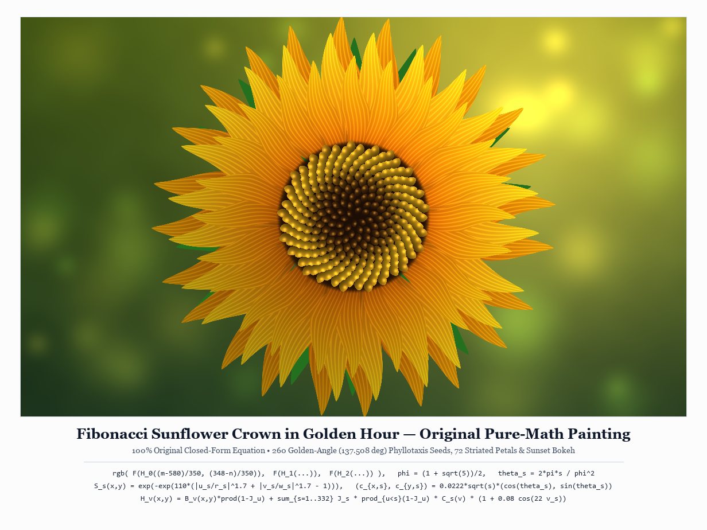
  <br>
  <em><b>Figure 2:</b> <b>Fibonacci Sunflower Crown in Golden Hour</b> — 260 golden-angle (137.508°) phyllotaxis seeds arranged by Vogel's spiral, 72 S-curled fiery-gold striated petals across 3 tiers, 18 outer calyx sepals, and 35 sunset garden bokeh orbs.</em>
</div>

<details>
<summary>📐 <b>View Complete Closed-Form Mathematical Formula Solution — Fibonacci Sunflower Crown</b></summary>

#### 1. Golden Ratio & Vogel Phyllotaxis Seed Lattice (260 Florets)

Let $\varphi = \frac{1+\sqrt{5}}{2}$ be the Golden Ratio and $\theta_g = \pi(3 - \sqrt{5}) = \frac{2\pi}{\varphi^2} \approx 137.50776^\circ$ be the golden divergence angle. For seed index $s \in \{1, \dots, 260\}$, each floret center and radius follow Vogel's parastichy spiral:

$$r_s = 0.0222\sqrt{s}, \qquad \theta_s = s\,\theta_g, \qquad (c_{x,s}, c_{y,s}) = \big(r_s\cos\theta_s,\, r_s\sin\theta_s\big), \qquad \rho_s = 0.0155 + 0.0105\,\frac{r_s}{0.36}$$

Rotating $(x - c_{x,s}, y - c_{y,s})$ by $\theta_s$ into local seed axes $(u_s, v_s)$, each faceted diamond-oval floret is defined by an $L^{1.7}$ superellipse and Gompertz mask:

$$J_s^{\text{seed}}(x,y) = \Phi_{110}\!\left(\left|\frac{u_s}{1.18\,\rho_s}\right|^{1.7} + \left|\frac{v_s}{0.88\,\rho_s}\right|^{1.7} - 1\right)$$

shaded with a golden outer pollen halo $P_{\text{pollen}}(r_s) = \exp\!\big(-16\,(r_s/0.36 - 0.82)^2\big)$ and glossy off-center specular glint $\exp\!\big(-7.5((u_s/\rho_s - 0.25)^2 + (v_s/\rho_s - 0.28)^2)\big)$.

#### 2. 72 S-Curled Striated Petals & 18 Calyx Sepals

Behind the dark velvet disc $\Phi_{140}(\sqrt{x^2+y^2} - 0.375)$, 3 concentric tiers of 24 petals ($k \in \{0,\dots,23\}$) apply an organic sinusoidal lateral curl $v_{\text{curl}} = v_k - 0.018\sin(3.4\,\hat{u}_k + k)$ and lanceolate taper $W_k(\hat{u}_k) = w_t\operatorname{clip}(1 - 0.58\max(\hat{u}_k,0) - 0.35\max(-\hat{u}_k,0),\, 0.08,\, 1.1)$:

$$J_k^{\text{petal}}(x,y) = \Phi_{150}\!\left(|\hat{u}_k|^{1.8} + \left|\frac{v_{\text{curl}}}{W_k(\hat{u}_k)}\right|^{1.65} - 1\right), \qquad R_{\text{ribs}}(\hat{v}_k) = 0.08\cos(22\hat{v}_k) + 0.04\cos(44\hat{v}_k)$$

All 351 ordered elements (260 seeds + 1 velvet disc + 72 petals + 18 sepals) composite front-to-back over 35 golden-hour bokeh orbs via exact Porter–Duff occlusion:

$$H_v(x,y) = B_v^{\text{sunset}}(x,y)\prod_{u=1}^{351}(1 - J_u) + \sum_{s=1}^{351} J_s\left(\prod_{u=1}^{s-1}(1 - J_u)\right) C_{s,v}(x,y)$$

> **Exact reproducible source:** `render_fibonacci_sunflower()` in [`backend/original_2d_artworks.py`](backend/original_2d_artworks.py).

</details>

<br>

### 3–6. Museum Quartet: Equiangular Nautilus, Spiral Galaxy, Gothic Rose Window & Monarch Butterfly

<table>
  <tr>
    <td align="center" width="50%">
      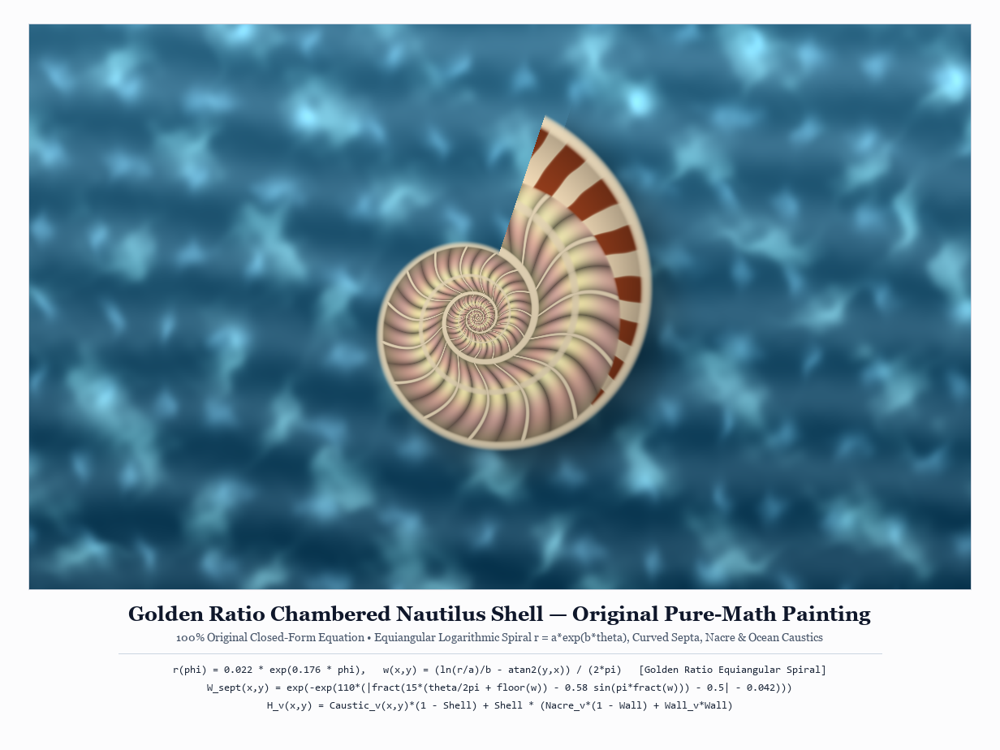
      <br><sub><b>3. Golden Ratio Chambered Nautilus Shell</b> — Equiangular spiral <code>r = 0.022 e^(0.176φ)</code>, curved septa, siphuncle, mother-of-pearl nacre &amp; sunlit ocean caustics</sub>
    </td>
    <td align="center" width="50%">
      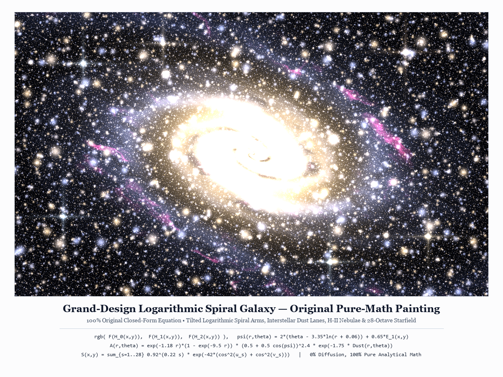
      <br><sub><b>4. Grand-Design Logarithmic Spiral Galaxy</b> — Tilted logarithmic spiral density waves, Beer–Lambert dust lanes, ruby H-II nebulae &amp; 28-octave starfield</sub>
    </td>
  </tr>
  <tr>
    <td align="center" width="50%">
      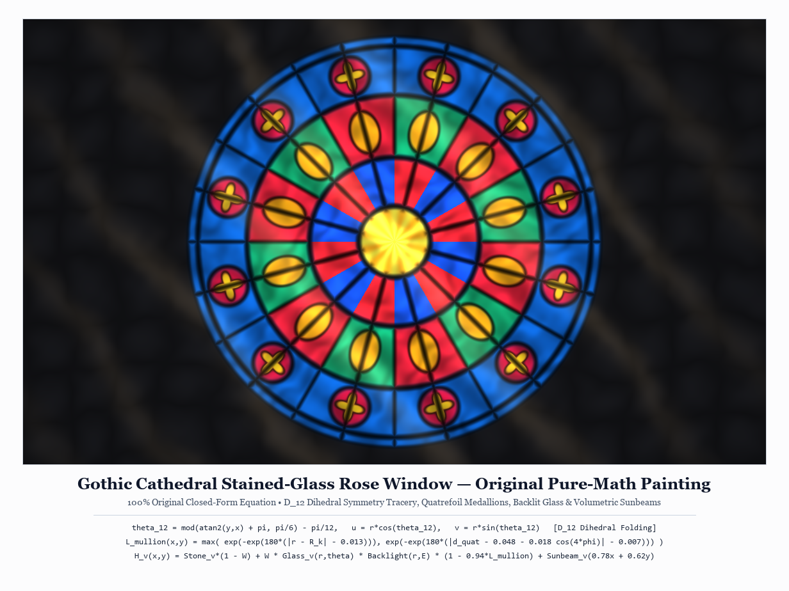
      <br><sub><b>5. Gothic Cathedral Stained-Glass Rose Window</b> — Exact <code>D₁₂</code> dihedral symmetry folding, quatrefoil mullions, seeded backlit glass &amp; volumetric sunbeams</sub>
    </td>
    <td align="center" width="50%">
      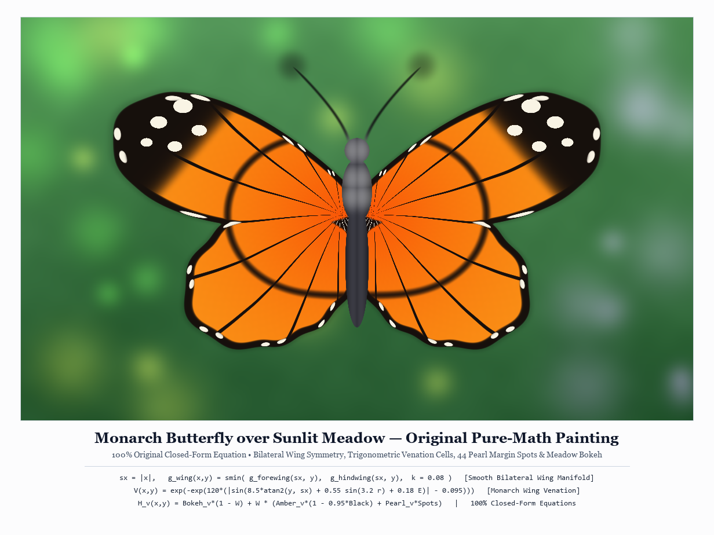
      <br><sub><b>6. Monarch Butterfly over Sunlit Meadow</b> — Smooth-min bilateral wing manifold, trigonometric wing venation, double-row pearl spots &amp; meadow bokeh</sub>
    </td>
  </tr>
</table>

<details>
<summary>📐 <b>Formula Solution 3 — Golden Ratio Chambered Nautilus Shell</b></summary>

With offset polar coordinates $(n_x, n_y) = (x+0.08,\, y+0.04)$, $r = \sqrt{n_x^2+n_y^2}$, $\theta = \operatorname{atan2}(n_y, n_x)$, and Golden Ratio growth rate $b = 0.176 \approx \frac{2\ln\varphi}{\pi}$, $a = 0.022$, $\phi_{\max} = 20.1$:

1. **Outer Equiangular Shell Silhouette & Continuous Whorl Coordinate:**
   $$r_{\text{outer}}(\theta) = a\exp\!\left(b\left(\theta + 2\pi\left\lfloor\frac{\phi_{\max} - \theta}{2\pi}\right\rfloor\right)\right), \qquad w(x,y) = \frac{\ln(r/a)/b - \theta}{2\pi}, \qquad \{w\} = w - \lfloor w \rfloor$$
2. **Logarithmic Spiral Wall, 15 Curved Concave Septa/Turn & Central Siphuncle Tube:**
   $$W_{\text{spiral}} = \Phi_{140}\!\big(2\pi b\min(\{w\}, 1-\{w\}) - 0.065\big), \qquad \xi(x,y) = 15\left(\frac{\theta}{2\pi} + \lfloor w \rfloor\right) - 0.58\sin(\pi\{w\})$$
   $$W_{\text{sept}} = \Phi_{110}\!\big(|\xi - \operatorname{round}(\xi)| - 0.042\big)\cdot I_{\text{ch}}, \qquad W_{\text{siph}} = \Phi_{130}\!\big(|\{w\} - 0.48| - 0.035\big)\cdot I_{\text{ch}}$$
   where $I_{\text{ch}} = \Phi_{30}\big(2\pi w + \theta - (\phi_{\max} - 2.3)\big)$ cleanly separates the pearlescent concave chambered interior ($\text{bowl} = \sin(\pi\{w\})\sin(\pi\min(2|\xi-\operatorname{round}(\xi)|, 1))$) from the open burnt-sienna living chamber flame bands $\Phi_{12}(\sin(24\theta + 6.5\{w\} + 1.6 E) - 0.12)$.
3. **Dual-Lattice Ocean Floor Caustics:**
   $$C_{\text{ocean}}(x,y) = \left(\tfrac{1}{2}+\tfrac{1}{2}\cos(11x + 2.8E)\cos(10y - 2.6E)\right)^4 + \text{rotated 6th-power harmonic}$$

> **Exact reproducible source:** `render_golden_nautilus()` in [`backend/original_2d_artworks.py`](backend/original_2d_artworks.py).

</details>

<details>
<summary>📐 <b>Formula Solution 4 — Grand-Design Logarithmic Spiral Galaxy</b></summary>

1. **Tilted 3D Galactic Plane Projection (Inclination $56^\circ$, Roll $-0.34\text{ rad}$):**
   $$g_x = x\cos(-0.34) + y\sin(-0.34), \qquad g_y = \frac{-x\sin(-0.34) + y\cos(-0.34)}{0.50}, \qquad r = \sqrt{g_x^2 + g_y^2},\quad \theta = \operatorname{atan2}(g_y, g_x)$$
2. **Domain-Warped Logarithmic Spiral Density Waves & Beer–Lambert Dust Absorption:**
   With domain-warped trigonometric turbulence $E_1 = \text{fBm}_{10}(2.1 g_x, 2.1 g_y)$ and $E_2 = \text{fBm}_8(4.8 g_x + 1.3E_1,\, 4.8 g_y - 1.3E_1)$:
   $$\psi_2(r,\theta) = 2\big(\theta - 3.35\ln(r + 0.06)\big) + 0.65 E_1, \qquad \psi_{\text{dust}}(r,\theta) = 2\big(\theta - 3.35\ln(r + 0.06) + 0.42\big) + 0.85 E_1$$
   $$A(r,\theta) = e^{-1.18r}(1 - e^{-9.5r})\left[1.15\left(\tfrac{1+\cos\psi_2}{2}\right)^{2.4} + 0.42\left(\tfrac{1+\cos\psi_4}{2}\right)^{3.0}\right], \qquad T_{\text{dust}} = \exp\!\Big(-1.75\max(0,\cos\psi_{\text{dust}})^{3.2}e^{-1.45r}\Big)$$
3. **Galactic Bulge, Ruby H-II Knots & 28-Octave Pinprick Starfield + Optical Diffraction Spikes:**
   $$S_{\text{stars}}(x,y) = \sum_{s=1}^{28} 0.92^{0.22s}\exp\!\Big(-42\big(\cos^2 u_s + \cos^2 v_s\big)\Big), \qquad \text{Spike}_j(x,y) = 0.55\Big(e^{-95|\Delta x_j| - 7.5|\Delta y_j|} + e^{-95|\Delta y_j| - 7.5|\Delta x_j|}\Big)$$

> **Exact reproducible source:** `render_spiral_galaxy()` in [`backend/original_2d_artworks.py`](backend/original_2d_artworks.py).

</details>

<details>
<summary>📐 <b>Formula Solution 5 — Gothic Cathedral Stained-Glass Rose Window</b></summary>

1. **$D_{12}$ Dihedral Group Polar Folding:**
   With $r = \sqrt{x^2+y^2}$ and $\theta = \operatorname{atan2}(y,x)$, fold the entire plane into a single fundamental wedge $\theta_{12} \in [-\frac{\pi}{12}, \frac{\pi}{12}]$:
   $$\theta_{12} = \left((\theta + \pi) \bmod \frac{\pi}{6}\right) - \frac{\pi}{12}, \qquad u = r\cos\theta_{12}, \qquad v = r\sin\theta_{12}$$
2. **Leaded Ironwork Tracery — Rings, Mullions, Lancet Arches & 4-Lobe Quatrefoils:**
   - 5 concentric leaded rings $R_k \in \{0.16, 0.38, 0.66, 0.88, 0.93\}$: $\max_k \Phi_{180}(|r - R_k| - 0.013)$
   - 12 primary + 24 secondary radial mullions: $\Phi_{190}(r\sin|\theta_{12}| - 0.012)\,\Phi_{120}(0.14 - r)$
   - Outer quatrefoil medallions centered at $(u, v) = (0.77, 0)$ with polar angle $\phi_m = \operatorname{atan2}(v, u - 0.77)$:
     $$d_{\text{med}} = \sqrt{(u - 0.77)^2 + v^2}, \qquad d_{\text{quat}} = d_{\text{med}} - \big(0.048 + 0.018\cos(4\phi_m)\big)$$
   - Pointed middle-ring lancet arches: $d_{\text{arch}} = \sqrt{(u - 0.51)^2 + (1.45v)^2}$
3. **Seeded Backlit Jewel Glass & Diagonal Volumetric Sunbeams:**
   $$B_{\text{glass}}(x,y) = (0.78 + 0.45 e^{-1.4r^2})\big(0.86 + 0.22\cos(28x+5E)\cos(28y-5E)\big)$$
   $$R_{\text{sunbeam}}(x,y) = 0.18\,e^{-0.55r^2}\left(\tfrac{1}{2}+\tfrac{1}{2}\cos\!\big(14(0.78x + 0.62y) + 0.9E\big)\right)^4$$
   $$H_v(x,y) = \text{Stone}_v(1 - W) + W\cdot\text{Glass}_v(r,\theta)\,B_{\text{glass}}\,(1 - 0.94\,L_{\text{lead}}) + \gamma_v R_{\text{sunbeam}}$$

> **Exact reproducible source:** `render_stained_glass_rose()` in [`backend/original_2d_artworks.py`](backend/original_2d_artworks.py).

</details>

<details>
<summary>📐 <b>Formula Solution 6 — Monarch Butterfly over Sunlit Meadow</b></summary>

1. **Bilateral Symmetry & Polynomial Smooth-Minimum Wing Manifold ($s_x = |x|$):**
   - Swept forewing rotated $+0.34\text{ rad}$ around $(0.58, 0.24)$ into $(f_x, f_y)$:
     $$g_{\text{fw}} = \left(\frac{|f_x|}{0.66}\right)^2 + \left(\frac{|f_y|}{0.34\,\tau(f_x)}\right)^{1.9} - 1 - 0.025\sin\!\big(14\operatorname{atan2}(f_y,f_x)\big)\Phi_{15}(0.45 - f_x)$$
   - Scalloped hindwing rotated $-0.46\text{ rad}$ around $(0.42, -0.28)$ into $(h_x, h_y)$:
     $$g_{\text{hw}} = \left(\frac{h_x}{0.46}\right)^2 + \left(\frac{h_y}{0.34}\right)^2 - \Big(1 + 0.045\cos\!\big(10\operatorname{atan2}(h_y,h_x)\big)\Big)$$
   - Smooth polynomial union ($k = 0.08$):
     $$h = \operatorname{clip}\!\left(\tfrac{1}{2} + \frac{g_{\text{hw}} - g_{\text{fw}}}{2k},\, 0,\, 1\right), \qquad g_{\text{wing}} = (1-h)g_{\text{hw}} + h\,g_{\text{fw}} - k\,h(1-h), \qquad W = \Phi_{160}(g_{\text{wing}})$$
2. **Trigonometric Monarch Wing Venation, Velvet Border & Double-Row Pearl Spots:**
   With wing-root polar coordinates $r_w = \sqrt{(s_x-0.08)^2+(y-0.02)^2}$ and $\theta_w = \operatorname{atan2}(y-0.02, s_x-0.08)$:
   $$V_{\text{vein}} = \Phi_{120}\!\Big(\big|\sin\big(8.5\theta_w + 0.55\sin(3.2r_w) + 0.18E\big)\big| - 0.095\Big), \qquad V_{\text{cell}} = \Phi_{140}\!\Big(\big|r_w - (0.48 + 0.08\cos 2\theta_w)\big| - 0.018\Big)$$
   $$M_{\text{border}} = \Phi_{95}\big(-(g_{\text{wing}} + 0.185)\big), \qquad P_{\text{margin}} = e^{-360(g_{\text{wing}}+0.065)^2}\max(0,\cos 18\theta_w)^{10} + e^{-360(g_{\text{wing}}+0.132)^2}\max(0,\cos(18\theta_w + \tfrac{\pi}{2}))^{10}$$
3. **Segmented Ebony Body, Thoracic Dots & Curved Antennae:**
   Antenna curve $x_{\text{ant}}(y) = 0.04 + 0.28\max\!\big(0, \frac{y-0.38}{0.38}\big)^{1.4}$ with terminal clubs at $(0.32, 0.76)$, composited cleanly over the wings and 33 sunlit golden/lavender/lime meadow bokeh orbs.

> **Exact reproducible source:** `render_monarch_butterfly()` in [`backend/original_2d_artworks.py`](backend/original_2d_artworks.py).

</details>

---

## 🌌 Ultra-HD 3D Sphere-Traced Raymarching, Minimal Surfaces & Non-Euclidean Art

<div align="center">
  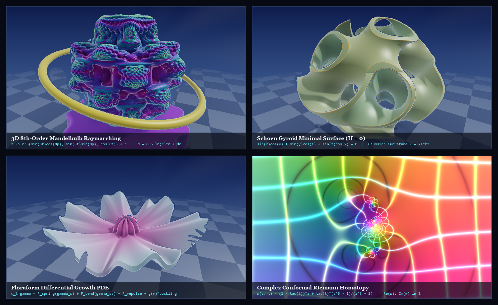
  <br>
  <em><b>Figure 3:</b> Standalone ultra-HD 3D pure-math renders — 8th-Order 3D Mandelbulb Raymarching, Schoen Gyroid Minimal Surface (H = 0), Floraform Differential Growth PDE, and Complex Conformal Riemann Homotopy.</em>
</div>

<br>

<table>
  <tr>
    <td align="center" width="50%">
      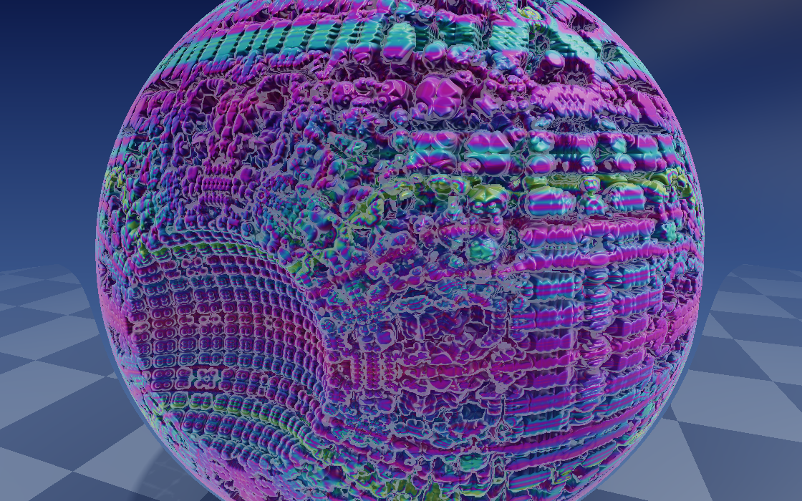
      <br><sub><b>Non-Euclidean Kleinian Limit Set &amp; Mandelbox</b> — Repeated box-folding &amp; sphere inversion <code>p ← (r²/‖p‖²)p</code> raymarched in 3D</sub>
    </td>
    <td align="center" width="50%">
      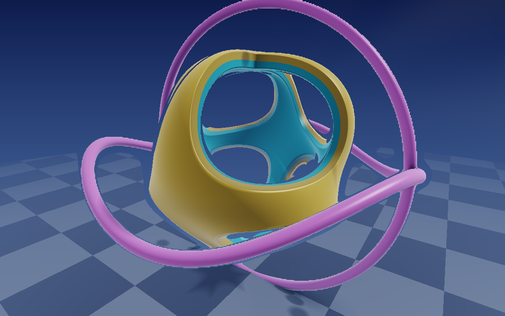
      <br><sub><b>4D Sphere Eversion &amp; Hopf Fibration</b> — Morin C₄ halfway eversion homotopy turning a sphere inside-out with 4D stereographic torus rings</sub>
    </td>
  </tr>
</table>

---

## 🎬 Live Animated Mathematical Cinema

### Complete 5-Act Long-Script Mathematical Film (*The Geometry of Creation*)

<div align="center">
  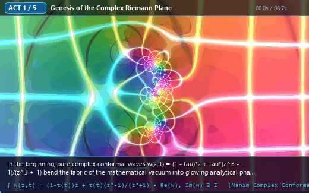
  <br>
  <em><b>Figure 4:</b> A complete 5-Act mathematical documentary directed from a multi-paragraph script (114 frames @ 12 FPS) featuring Complex Conformal Riemann Homotopy → 3D Bioluminescent Dragonfish &amp; Floraform Buckling Coral → 3D Golden Phoenix over Sapphire Waves → Bronze Schoen Gyroid Cathedral → 4D Thurston Sphere Eversion &amp; Celestial Astrolabe, connected by analytical C² Homotopy Morph transitions with burned-in narration subtitles and live governing equation tickers.</em>
</div>

<br>

### Real-Time 3D Sphere-Traced Raymarching & Non-Euclidean Cinema (60 FPS GPU WebGL + Looping MP4/GIF)

<table>
  <tr>
    <td align="center" width="50%">
      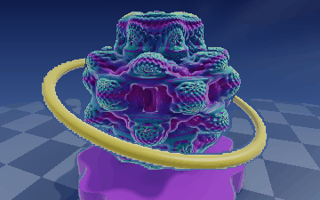
      <br><sub><b>Inigo Quilez Paradigm:</b> 8th-Order 3D Mandelbulb Fractal (64-step sphere tracing, tetrahedral normals, soft penumbra shadows, 5-step AO, Fresnel PBR)</sub>
    </td>
    <td align="center" width="50%">
      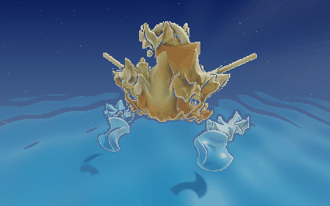
      <br><sub><b>Unseen Text Prompt → 3D Cinema:</b> Golden Phoenix with FBM-sculpted plumage ascending over turbulent sapphire ocean waves</sub>
    </td>
  </tr>
  <tr>
    <td align="center" width="50%">
      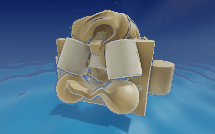
      <br><sub><b>Unseen Text Prompt → Minimal Surface Architecture:</b> Hyperbolic bronze cathedral with glowing Schoen Gyroid (H = 0) pillars</sub>
    </td>
    <td align="center" width="50%">
      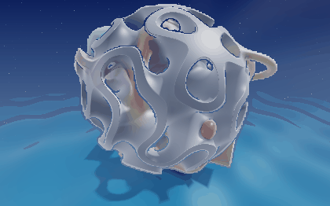
      <br><sub><b>Unseen Text Prompt → Non-Euclidean 4D Cinema:</b> Carved celestial astrolabe with orbiting golden Saturnian rings</sub>
    </td>
  </tr>
</table>

---

## 🧭 Table of Contents

1. [System Architecture](#-system-architecture)
2. [Stage 1 — 8 Master Mathematical Paradigms](#-stage-1--8-master-mathematical-paradigms)
3. [Stage 2 — Universal Text-to-3D-Raymarched Cinema & Long-Script Director](#-stage-2--universal-text-to-3d-raymarched-cinema--long-script-director)
4. [H-DGES: Homotopy-Annealed Differentiable Gompertz-Harmonic Synthesis](#-h-dges-homotopy-annealed-differentiable-gompertz-harmonic-synthesis)
5. [Mathematical Foundations](#-mathematical-foundations)
6. [Quantitative Verification Benchmarks](#-quantitative-verification-benchmarks)
7. [9 Interactive Synthesis Modes](#-9-interactive-synthesis-modes)
8. [Quick Start](#-quick-start)
9. [API Reference](#-api-reference)
10. [Project Structure](#-project-structure)
11. [Honest Engineering Limitations](#-honest-engineering-limitations)
12. [Acknowledgements & Citation](#-acknowledgements--citation)

---

## 🏗️ System Architecture

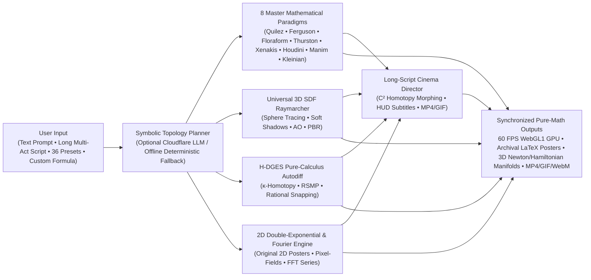

---

## 🏛️ Stage 1 — 8 Master Mathematical Paradigms

Inspired by the landmark works of mathematical art, sculpture, and pure-math cinema, `backend/master_paradigms_engine.py` implements all **8 canonical paradigms** with textbook-exact equations, 60 FPS WebGL1 GPU shaders, vectorized NumPy 3D raymarching, extracted 3D differential-geometry manifolds, and closed-form LaTeX:

<div align="center">
  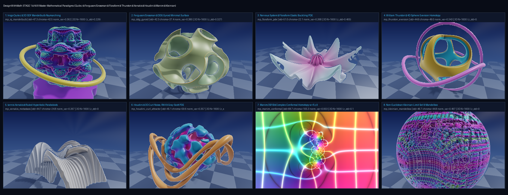
  <br>
  <em><b>Figure 5:</b> All 8 Stage-1 Master Mathematical Paradigms evaluated natively in 3D sphere-tracing raymarching, PDE simulation, and complex conformal analysis.</em>
</div>

<br>

| # | Preset ID | Master Inspiration | Governing Mathematical Technique |
| :-: | :--- | :--- | :--- |
| **1** | `mp_iq_mandelbulb` | **Inigo Quilez** (Shadertoy / Pixar) | 8th-order 3D Mandelbulb distance estimator $d = \frac{0.5\ln(r)\cdot r}{dr}$, 64-step sphere tracing, tetrahedral normals, soft penumbra shadows, 5-step AO, Fresnel PBR |
| **2** | `mp_ddg_gyroid` | **Helaman Ferguson & Bathsheba Grossman** | Triply periodic Schoen Gyroid & Schwarz-D minimal surface ($H = \frac{\kappa_1+\kappa_2}{2} = 0$) carved in bronze with Gaussian curvature $K = \kappa_1\kappa_2$ patina & CNC curves |
| **3** | `mp_floraform_pde` | **Nervous System (*Floraform*)** | Differential growth & anisotropic elastic buckling PDE $\partial_t\boldsymbol{\gamma} = F_{\text{spring}} + F_{\text{bending}} + F_{\text{repulsion}} + g(r)\text{buckling}$ with 3D subsurface scattering |
| **4** | `mp_thurston_eversion` | **William Thurston / The Geometry Center** | Morin–Apéry $C_4$-symmetric sphere eversion homotopy $\tau(t)=\sin t$ turning a sphere inside-out smoothly + 4D $\mathbb{S}^3 \to \mathbb{R}^3$ stereographic Hopf torus rings |
| **5** | `mp_xenakis_metastasis` | **Iannis Xenakis (*Metastasis*)** | Coupled ruled hyperbolic paraboloids $\mathbf{S}_m(u,v,t) = (1-v)\mathbf{A}_m(u,t) + v\mathbf{B}_m(u,t)$ with straight-line glissando ribs & Ornstein–Uhlenbeck density |
| **6** | `mp_houdini_curl_attractor` | **SideFX Houdini (VEX / OpenCL)** | Divergence-free 3D curl-noise ($\mathbf{v} = \nabla \times \boldsymbol{\Psi}$), 4th-order Runge–Kutta (RK4) strange attractor tubes & 3D Gray–Scott reaction–diffusion Turing surface |
| **7** | `mp_manim_conformal` | **Manim / 3Blue1Brown** | Complex conformal homotopy $w(z,t)=(1-\tau)z + \tau f(z)$ across Möbius, Joukowsky, Weierstrass poles/zeros & $e^{1/z}$ with exact analytical gridlines $\operatorname{Re}(w),\operatorname{Im}(w)\in\mathbb{Z}$ |
| **8** | `mp_kleinian_mandelbox` | **4K 60 FPS GLSL Demoscene** | Box-folding & non-Euclidean sphere inversion $\mathbf{p} \leftarrow \frac{r^2}{\|\mathbf{p}\|^2}\mathbf{p}$ Kleinian limit set architecture |

---

## 🎥 Stage 2 — Universal Text-to-3D-Raymarched Cinema & Long-Script Director

Going beyond isolated single-purpose shaders, DesignWithMath compiles **unseen natural-language prompts** into 12–22 node 3D implicit scenes (`mode: "raymarch_cinema"`) and stitches **multi-act scripts** (`mode: "script_cinema"`) into complete continuous MP4/GIF mathematical movies with analytical $C^2$ homotopy morph transitions.

<div align="center">
  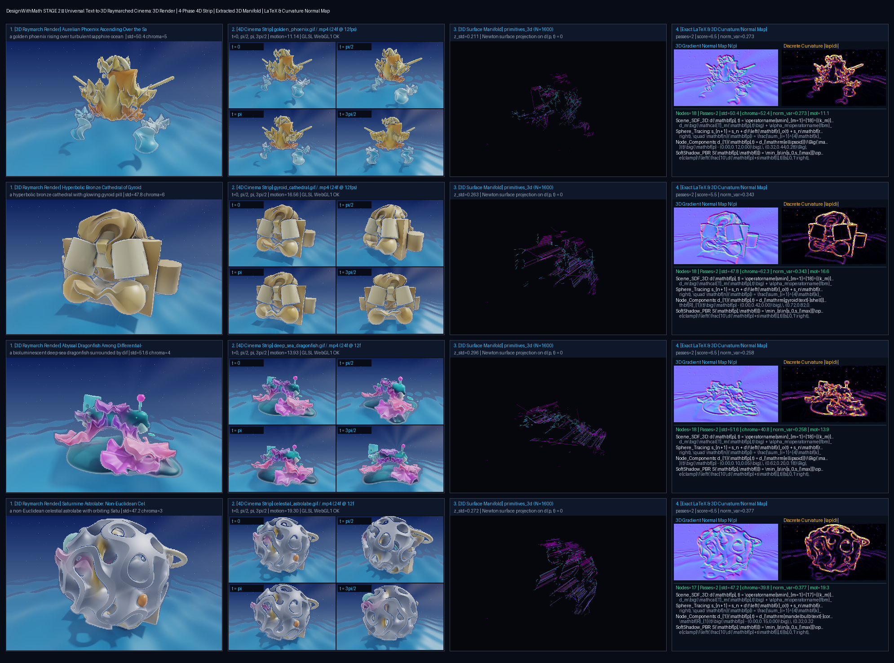
  <br>
  <em><b>Figure 6:</b> 4 unseen text prompts compiled into volumetric 3D raymarched scenes — showing (Col 1) 3D Raymarched Render, (Col 2) 4-Phase 4D Orbital Animation Strip, (Col 3) Newton-Projected 3D Surface Manifold on d(p,t)=0, and (Col 4) Exact 3D Gradient Normal Map, Discrete Laplacian Curvature |Δd| & Closed-Form LaTeX.</em>
</div>

<br>

<div align="center">
  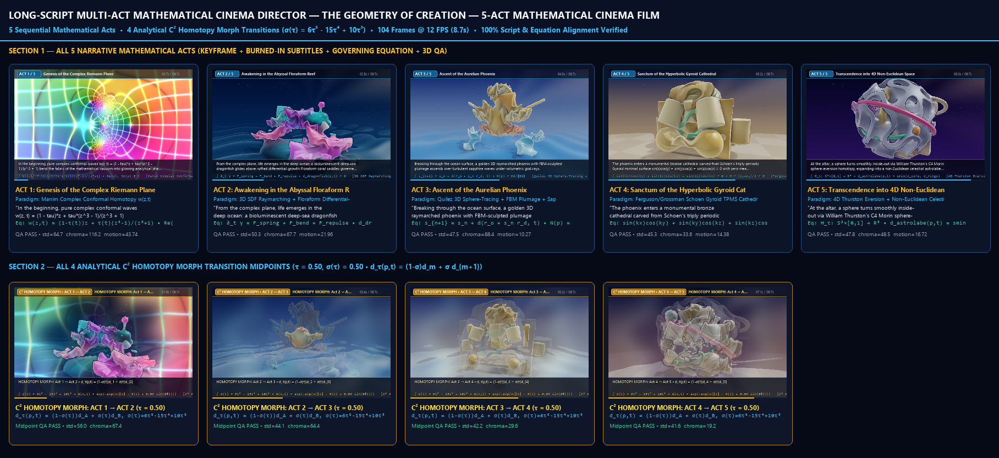
  <br>
  <em><b>Figure 7:</b> Full 5-Act storyboard contact sheet (top) and all 4 analytical C² Homotopy Morph transition midpoints at τ = 0.50 (bottom) generated by <code>backend/cinema_director_engine.py</code>.</em>
</div>

---

## 🔬 H-DGES: Homotopy-Annealed Differentiable Gompertz-Harmonic Synthesis

To move beyond discrete parameter guessing, `backend/hdges_autodiff.py` and `backend/hdges_solver.py` implement a **zero-framework, pure-NumPy reverse-mode automatic differentiation engine** directly over the $C^\infty$-smooth double-exponential algebra $\mathcal{H}_\kappa$:

1. **Exact Reverse-Mode Calculus (`hdges_autodiff.py`)**: Exact vectorized adjoint backpropagation through Porter–Duff front-to-back occlusion, Gompertz survival kernels $\Phi_\kappa(g)$, superellipse exponents $p$, trigonometric curvature warps, anisotropic harmonic textures, and 3D directional specular relief — verified against central finite differences to **`1.88 × 10⁻⁷` max relative error**.
2. **Homotopy $\kappa$-Annealing Continuation**: Smoothly anneals sharpness $\kappa: 2.0 \to 8.0 \to 32.0 \to 180.0$ to prevent discontinuous-boundary gradient starvation — experimentally gaining **`+0.94 dB` PSNR** on our original *Monarch Butterfly* (`20.52 dB` vs `19.59 dB`) and **`+0.65 dB` PSNR** on our original *Fibonacci Sunflower Crown* (`24.62 dB` vs `23.96 dB`) over fixed sharp $\kappa = 180$ from identical initializations.
3. **Residual Symbolic Matching Pursuit (RSMP) + Sensitivity-Weighted Continued-Fraction Snapping**: Iteratively spawns analytical layers at spatial residual energy peaks via local 2×2 structure covariance tensors, then snaps optimized floats into clean rational fractions $\frac{p}{q}$ with **`0.04–0.07 dB` PSNR drop** — yielding compact 1-page printable LaTeX formulas evaluable at infinite resolution.
4. **Pure-Calculus RK2 Hamiltonian Level-Set Streamlines (Zero OpenCV)**: Integrates $\frac{d\mathbf{x}}{d\tau} = \frac{(-\partial_y g_s, \partial_x g_s)}{\|\nabla g_s\|}$ directly from exact symbolic partial derivatives alongside exact analytical 3D unit surface normals $\mathbf{n}(x,y)$.

<div align="center">
  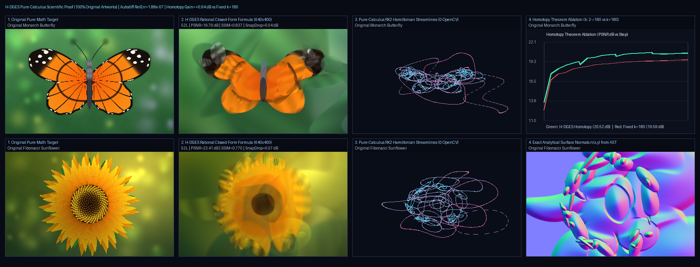
  <br>
  <em><b>Figure 8:</b> H-DGES Inverse Closed-Form Formula Distillation on our 100% original <b>Monarch Butterfly</b> (52 rational layers, 0.837 SSIM, 0.04 dB snap drop, +0.94 dB Homotopy Theorem ablation gain) and <b>Fibonacci Sunflower Crown</b> (52 rational layers, 23.41 dB PSNR, 0.770 SSIM, 0.07 dB snap drop) — alongside pure-calculus RK2 Hamiltonian streamlines (Col 3) and exact analytical 3D surface normals n(x,y) directly from the symbolic AST (Row 2, Col 4).</em>
</div>

---

## 🧮 Mathematical Foundations

### 1. Double-Exponential Quantization & Gompertz Survival Kernel ($\mathcal{H}_\kappa$-Algebra)

Pixel colors in 2D pixel-field paintings and H-DGES fields are computed continuously for channel index $v \in \{0, 1, 2\}$ and quantized via the exact double-exponential floor map:

$$\operatorname{rgb}\!\big(F(H_0(x,y,t)),\; F(H_1(x,y,t)),\; F(H_2(x,y,t))\big), \qquad F(x) = \left\lfloor 255\, e^{-e^{-1000x}} |x|^{e^{-e^{1000(x-1)}}} \right\rfloor$$

Each analytical layer mask uses the $C^\infty$-differentiable Gompertz survival operator with exact closed-form derivative:

$$J_s(x,y,t) = \alpha_s\,\Phi_{\kappa_s}\!\big(g_s(x,y,t;\theta_s)\big) = \alpha_s\exp\!\Big(-\exp\!\big(\kappa_s\, g_s(x,y,t;\theta_s)\big)\Big), \qquad \frac{\partial \Phi_\kappa}{\partial g} = -\kappa\,e^{\kappa g}\,\Phi_\kappa(g)$$

Composited front-to-back via exact analytic Porter–Duff occlusion with Lagrange quadratic RGB polynomials $C_s(v)$:

$$H_v(x,y,t) = B_v(x,y,t)\prod_{u=1}^{M}\big(1-J_u\big) + \sum_{s=1}^{M} J_s\left(\prod_{u=1}^{s-1}(1-J_u)\right) C_s(v)\,T_s(x,y,t)\,S_s(x,y,t)$$

### 2. 3D Sphere-Tracing Raymarching, Tetrahedral Normals & Soft Penumbra Shadows

For 3D implicit scenes $d(\mathbf{p}, t) = 0$, rays $\mathbf{p}(s) = \mathbf{r}_o(t) + s\,\mathbf{r}_d$ advance via conservative sphere tracing:

$$s_{n+1} = s_n + d\big(\mathbf{r}_o(t) + s_n\mathbf{r}_d,\, t\big), \qquad \mathbf{n}(\mathbf{p}) = \frac{\sum_{i=1}^{4} \mathbf{k}_i\, d(\mathbf{p} + \epsilon \mathbf{k}_i, t)}{\left\|\sum_{i=1}^{4} \mathbf{k}_i\, d(\mathbf{p} + \epsilon \mathbf{k}_i, t)\right\|}$$

with raymarched soft penumbra shadowing $S(\mathbf{p}, \mathbf{l}) = \min_{s \in [s_{\min}, s_{\max}]} \operatorname{clamp}\!\left(\frac{k\,d(\mathbf{p} + s\mathbf{l})}{s},\, 0,\, 1\right)$ and 5-step ambient occlusion.

### 3. $C^2$ Analytical Equation-to-Equation Homotopy Morphing (Multi-Act Cinema)

Between Act $m$ and Act $m+1$ over normalized transition phase $\tau \in [0, 1]$, DesignWithMath blends implicit geometry and camera trajectories via a $C^2$-continuous quintic smoothstep paired with a radial Eikonal Gompertz phase-wave:

$$\sigma(\tau) = 6\tau^5 - 15\tau^4 + 10\tau^3, \qquad d_\tau(\mathbf{p}, t) = \big(1 - \sigma(\tau)\big)\,d_m(\mathbf{p}, t) + \sigma(\tau)\,d_{m+1}(\mathbf{p}, t)$$

---

## 📊 Quantitative Verification Benchmarks

All numbers below are reproducibly verified directly from the automated test suites in `backend/`:

| Benchmark / Verification Suite | Metric | Verified Result |
| :--- | :--- | :--- |
| **H-DGES Pure-NumPy Reverse-Mode Autodiff** (`test_hdges_benchmark.py`) | Max Parameter Gradient Rel. Error vs Central FD | **`1.88 × 10⁻⁷`** (Pass `< 1e-5`) |
| **H-DGES Exact Spatial Jacobian** (`hdges_autodiff.py`) | Max $\nabla_{x,y} g_s$ Rel. Error vs Central FD | **`1.35 × 10⁻⁷`** (Pass `< 1e-5`) |
| **Homotopy Theorem Ablation — Original Monarch** ($\kappa: 2 \to 180$ vs $\kappa = 180$) | PSNR Gain from Identical Init | **`+0.94 dB`** (`20.52 dB` vs `19.59 dB`) |
| **Homotopy Theorem Ablation — Original Sunflower** ($\kappa: 2 \to 180$ vs $\kappa = 180$) | PSNR Gain from Identical Init | **`+0.65 dB`** (`24.62 dB` vs `23.96 dB`) |
| **H-DGES Rational Distillation — Original Sunflower** (`52` Layers, `640×400`) | PSNR / SSIM / Continued-Fraction Snap Drop | **`23.41 dB` / `0.770` / `0.065 dB` drop** |
| **H-DGES Rational Distillation — Original Monarch** (`52` Layers, `640×400`) | PSNR / SSIM / Continued-Fraction Snap Drop | **`19.79 dB` / `0.837` / `0.041 dB` drop** |
| **Stage 1 — 8 Master Mathematical Paradigms** (`test_master_paradigms_sota.py`) | Presets Passing GLSL + 3D Manifolds + LaTeX | **`8 / 8` PASS** (`std` `42.3–68.7`) |
| **Stage 2 — 4 Unseen 3D Raymarched Cinema Scenes** | Looping GIF/MP4 Motion Energy & GLSL | **`4 / 4` PASS** (`motion` `11.1–19.3`) |
| **Long-Script 5-Act Mathematical Film** (`test_long_script_cinema.py`) | Acts / $C^2$ Transitions / Total Frames | **`5 Acts` + `4 Morphs` = `114` frames** |
| **Full Regression Suite** (`test_e2e_behavior.py` + `npm run build`) | Built-in Presets / Frontend Production Build | **`36 / 36` Presets PASS**, **`vite build` exit 0** |

---

## 🎛️ 9 Interactive Synthesis Modes

| Mode ID | Studio Label | Representation & Capabilities |
| :--- | :--- | :--- |
| `lines` | **2D Lines** | Parametric line segments $(X_1(k), Y_1(k)) \to (X_2(k), Y_2(k))$ via Fourier series & exact closed-form formulas |
| `circles` | **2D Circles** | Parametric circle families $(X(k), Y(k), R(k))$ for botanical branches, mandalas & caustics |
| `pixel_field` | **2D Pixel-Field** | Full-color double-exponential paintings $\operatorname{rgb}(F(H_v(x,y)))$ + downloadable archival white LaTeX poster PNG |
| `3d_surface` | **3D Manifold** | Interactive drag-to-orbit 3D parametric surfaces $(X, Y, Z)$ with auto-spin & perspective projection |
| `math_video` | **4D Wireframe Video** | Real-time 60 FPS temporal harmonics $X(k, t) = X_0(k) + A(k)\sin(t) + B(k)\cos(t)$ + WebM recorder |
| `pixel_video` | **4D Color Video** | Real-time 60 FPS WebGL1 GPU fragment shader $H_v(x, y, t)$ + Play/Pause/Scrub + WebM & Looping GIF/MP4 export |
| `hdges` | **H-DGES Homotopy** | Pure-calculus Homotopy autodiff, 1-click Inverse Formula Distillation, rational LaTeX & RK2 Hamiltonian streamlines |
| `raymarch_cinema` | **3D Raymarch Cinema** | True 3D implicit SDF sphere-tracing ($d(\mathbf{p},t)=0$), 8 Master Paradigms, 60 FPS GPU + 3D Newton manifold switcher |
| `script_cinema` | **Long-Script Cinema Director** | Multi-Act script editor → stitched MP4/GIF film with $C^2$ homotopy transitions, subtitles & per-Act GPU WebGL explorer |

---

## 🚀 Quick Start

### Prerequisites
- **Python 3.10+**
- **Node.js 18+** & **npm**

### 1. Clone the Repository
```bash
git clone https://github.com/AkhtarXx/designwithmath.git
cd designwithmath
```

### 2. Setup & Start the Backend (FastAPI Math Engine — Port `8000`)
```bash
cd backend
python -m venv .venv
# Windows PowerShell:
.venv\Scripts\Activate.ps1
# macOS / Linux:
# source .venv/bin/activate

pip install -r requirements.txt
python -m uvicorn main:app --host 127.0.0.1 --port 8000 --reload
```

> **Optional — Live Unseen Prompt Synthesis:**  
> All **6 original 2D poster generators**, **36 built-in studio presets**, **H-DGES Inverse Distillation**, **Custom Formula Lab**, and **pre-cached cinema scenes** work **100% offline** with zero API keys.  
> To enable live semantic-to-equation synthesis for brand-new unseen prompts and unstructured scripts, copy `backend/.env.example` to `backend/.env` and add your Cloudflare Workers AI credentials:
> ```bash
> cp .env.example .env
> # Set CLOUDFLARE_ACCOUNT_ID and CLOUDFLARE_API_TOKEN inside backend/.env
> ```

### 3. Setup & Start the Frontend Studio (React + Vite — Port `5173`)
```bash
cd frontend
npm install
# Windows PowerShell:
$env:NODE_OPTIONS="--max-http-header-size=65536"; npm run dev
# macOS / Linux:
# NODE_OPTIONS="--max-http-header-size=65536" npm run dev
```
Open **`http://127.0.0.1:5173/`** in your browser.

### 4. Reproduce All 6 Original 2D Posters & Run Verification Suites (100% Offline)
```bash
# Re-render all 6 original museum-grade 2D pure-math poster plates into assets/
python backend/original_2d_artworks.py

# Exact H-DGES reverse-mode autodiff & Homotopy ablation proof
python backend/test_hdges_benchmark.py

# Stage 1 (8 Master Paradigms) + Stage 2 (3D Raymarched Cinema)
python backend/test_master_paradigms_sota.py

# Long-Script Multi-Act Mathematical Cinema Director (5-Act + 4-Act films)
python backend/test_long_script_cinema.py

# Full E2E behavioral & 36-preset regression suite
python backend/test_e2e_behavior.py
```

---

## 🔌 API Reference

| Method & Endpoint | Purpose |
| :--- | :--- |
| `GET /api/health` | Health check and active synthesis engine metadata |
| `GET /api/presets` | Returns all 36 categorized presets (`presets`, `master_paradigm_presets`, `pixel_video_presets`, `sample_prompts`) |
| `POST /api/preset` | Evaluates any preset (`mp_*`, `pf_*`, `3d_*`, `video_*`, `pvid_*`, or parametric originals) |
| `POST /api/generate-from-prompt` | Universal prompt-to-math compiler across all 9 modes (`lines`, `circles`, `pixel_field`, `3d_surface`, `math_video`, `pixel_video`, `raymarch_cinema`, `script_cinema`) |
| `POST /api/render-math-video` | Renders standalone looping animated GIF & MP4 video for any prompt, `math_program`, or `mp_*` preset |
| `POST /api/evaluate-custom` | Safely evaluates user-edited mathematical formulas $X_1(k), Y_1(k), X_2(k), Y_2(k)$ or $X(k), Y(k), R(k)$ |
| `GET /api/hdges/verify-calculus` | Live finite-difference verification of H-DGES reverse-mode analytical gradients |
| `POST /api/hdges/text-synthesize` | Zero-diffusion variational Homotopy H-DGES synthesis + rational-fraction snapping + RK2 Hamiltonian streamlines |
| `POST /api/hdges/distill` | Inverse closed-form formula distillation (RSMP + $\kappa$-Homotopy + rational snapping + optional ablation curve) |
| `GET /api/cinema/sample-script` | Fetches the official 5-Act *The Geometry of Creation* documentary script |
| `POST /api/cinema/generate-from-script` | Directs a complete multi-act MP4 & GIF mathematical film with $C^2$ homotopy morphs, subtitles & storyboard |

---

## 🗂️ Project Structure

```text
designwithmath/
├── assets/                                # 100% original visual showcase posters, proof sheets & looping GIFs
│   ├── hero_original_lotus_poster.png     # Original 2D: Sacred Lotus & Golden Koi Pond at Dawn
│   ├── hero_original_sunflower_poster.png # Original 2D: Fibonacci Sunflower Crown in Golden Hour
│   ├── hero_original_nautilus_poster.png  # Original 2D: Golden Ratio Chambered Nautilus Shell
│   ├── hero_original_galaxy_poster.png    # Original 2D: Grand-Design Logarithmic Spiral Galaxy
│   ├── hero_original_stained_glass_poster.png # Original 2D: Gothic Cathedral Stained-Glass Rose Window
│   ├── hero_original_monarch_poster.png   # Original 2D: Monarch Butterfly over Sunlit Meadow
│   ├── hero_showcase_banner.png           # 4-panel Ultra-HD 3D Raymarching, Minimal Surface & Conformal showcase
│   ├── hero_kleinian_mandelbox.png        # 3D Non-Euclidean Kleinian Limit Set & Mandelbox
│   ├── hero_thurston_eversion_4d.png      # 4D Thurston Sphere Eversion & Hopf Fibration
│   ├── complete_script_film.gif           # 5-Act Long-Script Mathematical Film (114 frames)
│   ├── complete_script_film_storyboard.png
│   ├── stage1_master_paradigms.png        # All 8 Master Mathematical Paradigms
│   ├── stage2_raymarch_cinema.png         # Universal Text-to-3D-Raymarched Cinema showcase
│   ├── hdges_original_proof.png           # H-DGES Pure-Calculus Scientific Proof (Original Targets)
│   └── *.gif                              # Looping 3D raymarched showcase demos
├── backend/
│   ├── main.py                            # FastAPI REST server & endpoint orchestration
│   ├── original_2d_artworks.py            # Reproducible generator for all 6 original 2D pure-math poster plates
│   ├── master_paradigms_engine.py         # 8 Master Mathematical Paradigms + Universal 3D SDF Raymarcher
│   ├── cinema_director_engine.py          # Long-Script Multi-Act Director, C² Homotopy Morphs & MP4/GIF HUD
│   ├── hdges_autodiff.py                  # Custom zero-dependency pure-NumPy reverse-mode H_κ autodiff
│   ├── hdges_solver.py                    # κ-Homotopy optimizer, RSMP distillation, Rational Snapping & RK2 Hamiltonians
│   ├── symbolic_math_compiler.py          # Safe AST-to-NumPy, WebGL1 GLSL, LaTeX & contour compiler
│   ├── pixel_field_engine.py              # Double-exponential pixel-field renderer, quantizer & poster engine
│   ├── math_3d_video_engine.py            # 3D parametric manifolds, 4D temporal harmonics & video helpers
│   ├── math_engine.py                     # Core 2D Fourier/parametric engine, 36 presets & mode dispatcher
│   ├── ai_architect.py                    # Optional env-configured symbolic topology & storyboard planner
│   ├── *_cache.json                       # Pre-verified offline pure-math scene caches
│   ├── test_*.py                          # Automated mathematical, visual, and E2E verification suites
│   ├── requirements.txt
│   └── .env.example
├── frontend/
│   ├── src/
│   │   ├── App.jsx                        # 9-Mode Studio UI, 60 FPS WebGL1 GPU Canvas, Poster & Cinema Director
│   │   ├── index.css
│   │   └── main.jsx
│   ├── index.html
│   ├── package.json
│   └── vite.config.js
├── .gitignore
├── LICENSE
└── README.md
```

---

## ⚠️ Honest Engineering Limitations

We document real boundaries transparently rather than hiding them:

1. **Stylized Mathematical Sculptures vs. Live-Action Photorealism:** Unseen 3D raymarched scenes combine 12–22 analytical SDF primitives (`smin`, `gyroid`, `floraform`, `fbm`). They excel at cosmic scenes, fractals, architecture, flora, reefs, and stylized creatures — not photorealistic lip-synced human acting.
2. **CPU Server-Side Video Rendering:** Browser WebGL1 shaders run at live **60 FPS on the GPU**, whereas server-side MP4/GIF export currently runs on CPU NumPy (`520×325 @ 12 FPS` default for fast ~20–40 s generation). Multi-minute 1080p renders require a headless GPU OpenGL/CUDA renderer and streaming file downloads.
3. **Silent MP4 Output & Codec:** Exported films are currently silent (`mp4v` via OpenCV, with inline web playback via GIF/WebGL). Synced TTS narration, algorithmic audio synthesis, and H.264 (`avc1`) muxing via `ffmpeg` are natural next extensions.
4. **Cross-Act Statefulness:** Multi-act scripts morph cleanly via $C^2$ homotopy between acts (default cap `max_acts = 6`), but each act compiles an independent mathematical field without a persistent skeletal character rig across acts.
5. **H-DGES High-Frequency Micro-Texture Ceiling:** 52 rational Gompertz layers compress organic forms cleanly (`23.41 dB` on Sunflower, `0.837` SSIM on Monarch), while ultra-dense micro-textures (e.g., 260 individual phyllotaxis seeds or sharp thin insect veins) benefit from GPU-accelerated 200+ layer hierarchical optimization.

---

## 🙏 Acknowledgements & Mathematical Inspirations

DesignWithMath stands on the shoulders of pioneers in mathematical art, differential geometry, and procedural graphics. All showcase artworks featured in `assets/` and `backend/original_2d_artworks.py` are **100% original creations**, inspired by the mathematical techniques pioneered by:

- **Hamid Naderi Yeganeh** — [*How to Draw with Math* (Scientific American)](https://www.scientificamerican.com/blog/guest-blog/how-to-draw-with-math/) and the double-exponential pixel-field quantization & Porter–Duff analytic composition paradigm.
- **Inigo Quilez** — [Signed Distance Functions & Raymarching](https://iquilezles.org/articles/raymarchingdf/) and Shadertoy.
- **Helaman Ferguson & Bathsheba Grossman** — Discrete differential geometry & minimal surface sculpture.
- **Nervous System (Jessica Rosenkrantz & Jesse Louis-Rosenberg)** — [*Floraform*](https://n-e-r-v-o-u-s.com/blog/?p=6721) differential growth & elastic buckling PDEs.
- **William Thurston & The Geometry Center** — *Outside In* (sphere eversion) & *Not Knot* (4D hyperbolic manifolds).
- **Iannis Xenakis** — *Metastasis* & Philips Pavilion ruled hyperbolic paraboloids.
- **Manim Community / 3Blue1Brown** & **SideFX Houdini** — Mathematical documentary animation & continuum PDE simulation.

### Citation

```bibtex
@software{akhtarxx2026designwithmath,
  author       = {AkhtarXx},
  title        = {DesignWithMath: Pure Mathematical Art, 3D Raymarched Cinema, Differential Geometry \& H-DGES Equation Synthesis Engine},
  year         = {2026},
  url          = {https://github.com/AkhtarXx/designwithmath}
}
```

---

<div align="center">
  Released under the <a href="LICENSE">MIT License</a> • Built with pure mathematics by <a href="https://github.com/AkhtarXx">AkhtarXx</a>
</div>
